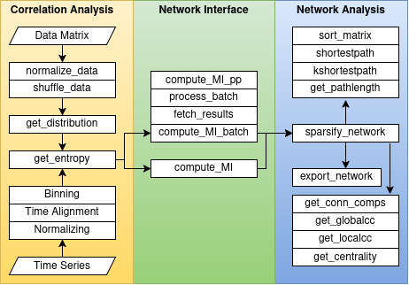

# NETSCOPE
An R package for information-theoretic network construction and analysis.

NETSCOPE is an R port of the original [NETSCOPE MATLAB/Octave/Python toolbox](https://github.com/DepartmentofNeurophysiology/NETSCOPE), developed with assistance from Claude.

## Introduction

NETSCOPE supports network construction and analysis across a wide variety of biological data. Applications include constructing gene co-expression networks, identifying genes or pathways of interest through network topology, and examining functional connectivity in fMRI and EEG data.

The package computes pairwise mutual information (MI) between variables, sparsifies the resulting networks using the Data Processing Inequality (DPI), and provides tools for network analysis, including centrality measures, shortest paths, connected components, and clustering coefficients.

## Installation

Once NETSCOPE is available on CRAN, install it using:

```r
install.packages("NETSCOPE")
```

Alternatively, install the development version from GitHub:

```r
# install.packages("remotes")
remotes::install_github("Neuronext/NETSCOPE-R")
```

## Documentation



For function-specific documentation, use `?<function>` or `help(<function>)` to see detailed
documentation for any function in the package.

```r
?compute_MI
?normalize_MI
?sparsify_network
```

## Example

The following example demonstrates how to construct a mutual information (MI) matrix from a small synthetic dataset.

```r
library(NETSCOPE)

# Generate example data (variables in rows, observations in columns)
set.seed(123)
data <- matrix(rnorm(300), nrow = 3)

# Compute pairwise mutual information
mi <- compute_MI(data)

# Display the MI matrix
mi
```

By default, `compute_MI()` uses the Freedman–Diaconis rule to determine the number of bins for estimating mutual information. Alternative binning methods, such as Sturges' rule, are also available.

## Manuscript

Bergmans, T., Jamal, T., Rezeika, A., Hsing, C.-C., & Celikel, T. (2026). *NETSCOPE: Information-Theory Based Network Discovery and Analysis* (Version 3) [Preprint]. bioRxiv. https://doi.org/10.1101/2022.04.18.488630

## Authors

The R implementation was developed at the Georgia Institute of Technology, School of Psychology and Brain Sciences, based on the original NETSCOPE toolbox.

See the package `DESCRIPTION` file for the complete list of contributors.
